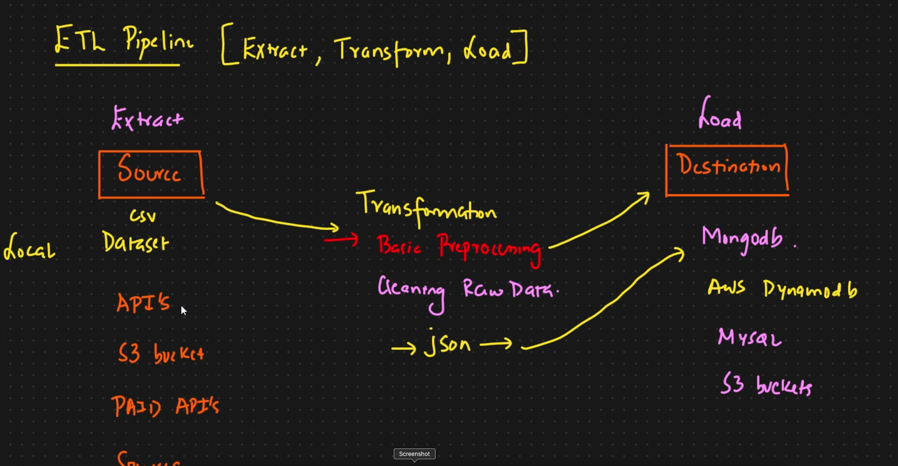
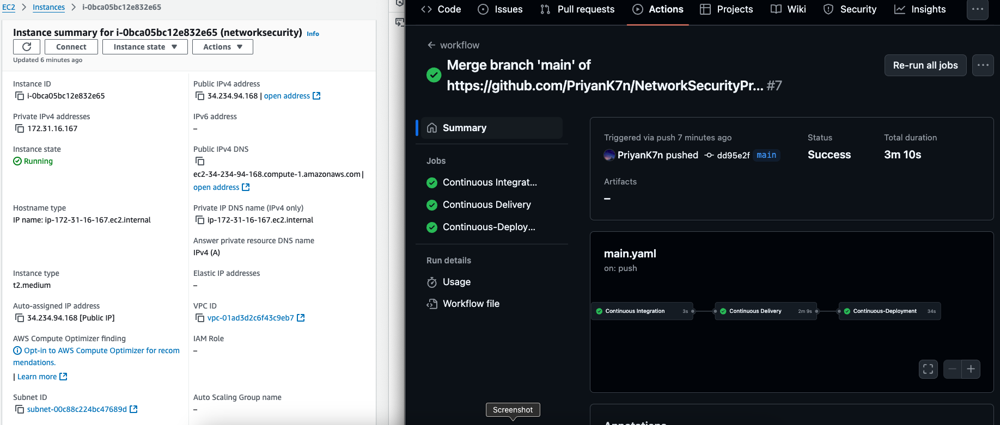
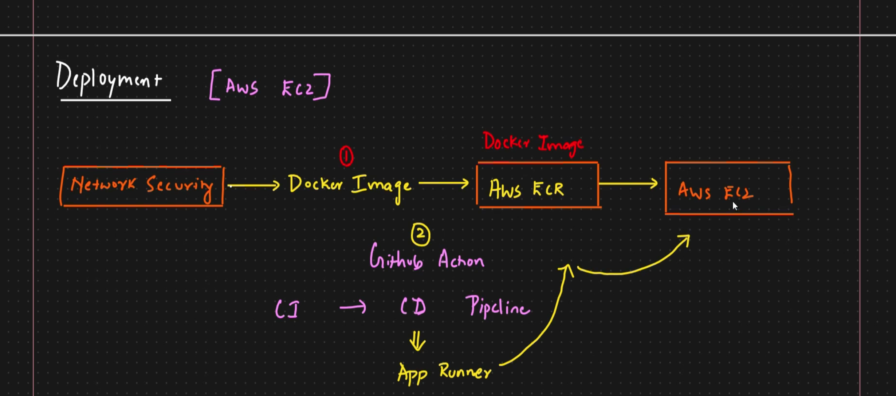

# Network Security Project for Phishing Data

## Data:
We downloaded Phishing Data from the Internet and it is present in the `Network_Data` folder. The dataset (`phisingData.csv`) contains 11,054 samples with 30 features and 1 target column (`Result`). All columns are integer-valued. Features capture URL-based, domain-based, and page-based characteristics used to classify websites as phishing (`-1`) or legitimate (`1`).

## ETL Pipeline: Extract, Transform, Load

Step 1: Extraction: We read data from multiple data sources and store it locally

Step 2: Transformation
* It involves basic preprocessing
* It involves cleaning raw data
* It involves combining data into a single dataframe as a .json for loading purposes to MongoDB database

Step 3: Loading
We load it into a database, in our case MongoDB Atlas Cloud. The `push_data.py` script handles this — it reads `Network_Data/phisingData.csv`, converts rows to JSON records, and inserts them into the MongoDB collection (`NetworkData` in database `priyankn`).

### Data Ingestion:

The Data Ingestion component is responsible for initiating and executing the data retrieval process. It reads raw data from MongoDB, processes it for ML tasks, and splits it into training and testing datasets. The ingestion component creates a **DataIngestionArtifact**, which contains the paths to the processed train and test datasets.

#### Configuration
* **DataIngestionConfig**: Configures the Data Ingestion component by defining the data sources (MongoDB database and collection names), output paths (feature store, train/test file paths), and the train-test split ratio (0.2).
* **DataIngestionArtifact**: Serves as the output from the ingestion process, housing the **trained_file_path** and **test_file_path** that are passed to subsequent components.

#### Data Ingestion Process
The steps involved in the Data Ingestion process are:

1. **export_collection_as_dataframe()**:
   * Reads data directly from MongoDB and returns it as a Pandas DataFrame. Drops the MongoDB `_id` column and replaces `"na"` strings with `np.nan`.
2. **export_data_into_feature_store()**:
   * Stores the retrieved DataFrame as a CSV file into a feature store directory, making it accessible for transformation and modeling stages.
3. **split_data_as_train_test()**:
   * Splits the data from the feature store into training and testing datasets (80/20 split using sklearn's `train_test_split`), preparing it for machine learning tasks.

#### Running Data Ingestion:
To run the data ingestion component, execute `main.py` which configures and runs the Data Ingestion process, initializing it through `DataIngestionConfig` and capturing its output in the `DataIngestionArtifact`.

### Data Validation:

The Data Validation component verifies that ingested data conforms to the expected schema and checks for data drift between the training and testing datasets. It takes the **DataIngestionArtifact** as input and produces a **DataValidationArtifact**.

#### Data Validation Process
1. **validate_number_of_columns()**: Checks that the number of columns in the train and test DataFrames matches the schema defined in `data_schema/schema.yaml` (31 columns: 30 features + 1 target).
2. **validate_numerical_columns()**: Verifies that all required numerical columns specified in the schema are present in the DataFrame.
3. **detect_dataset_drift()**: Uses the Kolmogorov-Smirnov two-sample test (`scipy.stats.ks_2samp`) on each column between train and test sets. A p-value below the threshold (0.05) indicates drift. Results are saved as a YAML drift report.

#### Configuration
* **DataValidationConfig**: Defines paths for valid/invalid data directories and the drift report file.
* **DataValidationArtifact**: Contains the validation status (boolean), paths to valid and invalid train/test files, and the drift report file path.

### Data Transformation:

The Data Transformation component handles missing value imputation and prepares the data for model training. It takes the **DataValidationArtifact** as input and produces a **DataTransformationArtifact**.

#### Data Transformation Process
1. **Imputation**: Uses a **KNNImputer** (n_neighbors=3, weights="uniform") wrapped in a sklearn `Pipeline` to handle missing values in the feature columns.
2. **Target Encoding**: Converts the target column `Result` from -1/1 to 0/1 for binary classification.
3. **Output**: Saves transformed train and test data as `.npy` arrays, and saves the fitted preprocessor pipeline as a pickle file (both in the artifact directory and in `final_model/preprocessor.pkl`).

### Model Training:

The Model Trainer component trains and evaluates multiple classification models, selects the best one, and saves it. It takes the **DataTransformationArtifact** as input and produces a **ModelTrainerArtifact**.

#### Models Evaluated
Five classifiers are compared using **GridSearchCV** (3-fold cross-validation) for hyperparameter tuning:
* **Random Forest** — tuned on `n_estimators`: [8, 16, 32, 128, 256]
* **Decision Tree** — tuned on `criterion`: ['gini', 'entropy', 'log_loss']
* **Gradient Boosting** — tuned on `learning_rate`, `subsample`, and `n_estimators`
* **Logistic Regression** — default parameters
* **AdaBoost** — tuned on `learning_rate` and `n_estimators`

Model selection is based on the best test R² score. Classification metrics (F1 score, precision, recall) are computed for both train and test sets and logged to **MLflow** via **DagsHub** for experiment tracking.

The best model is saved to `final_model/model.pkl` and the `ModelTrainerArtifact` records the trained model path along with train/test classification metrics.

### Note:
* Each component outputs an artifact, defined as dataclasses within `artifact_entity.py`.
* Input configurations for each component are managed via respective `config_entity` classes, ensuring modularity and reusability.
* The `final_model` folder houses the best model (`model.pkl`) and the data preprocessor object (`preprocessor.pkl`) as pickle files.
* Custom exception handling (`NetworkSecurityException`) and logging are used throughout the project.

## Steps in Project:
1. Write 4 Components:
   1. Data Ingestion Process
   2. Data Validation Process
   3. Data Transformation Process
   4. Model Training Process
2. Create a Training Pipeline (orchestrates all 4 components sequentially and syncs artifacts/models to AWS S3 bucket `networksecuritybucket97`)
3. Creating API Prediction using FastAPI (`app.py`):

Input is:
- best model (`final_model/model.pkl`)
- preprocessor object (`final_model/preprocessor.pkl`)

  Endpoints:
   1. **`GET /train`** — Triggers the full training pipeline
   2. **`POST /predict`** — Batch prediction: accepts a CSV file upload (without the `Result` target column), runs preprocessing and prediction using a `NetworkModel` wrapper, saves output to `prediction_output/output.csv` with a `predicted_Result` column appended, and renders results as an HTML table via Jinja2 templates.

4. Deployment of the Network Phishing Data Detection application as a Docker container

## Deployment Steps of Network Security Application in AWS:
The Docker image is built from `python:3.9.20-slim-bookworm`, installs AWS CLI and Python dependencies from `requirements.txt`, and runs the FastAPI application on port 8000 via uvicorn.

